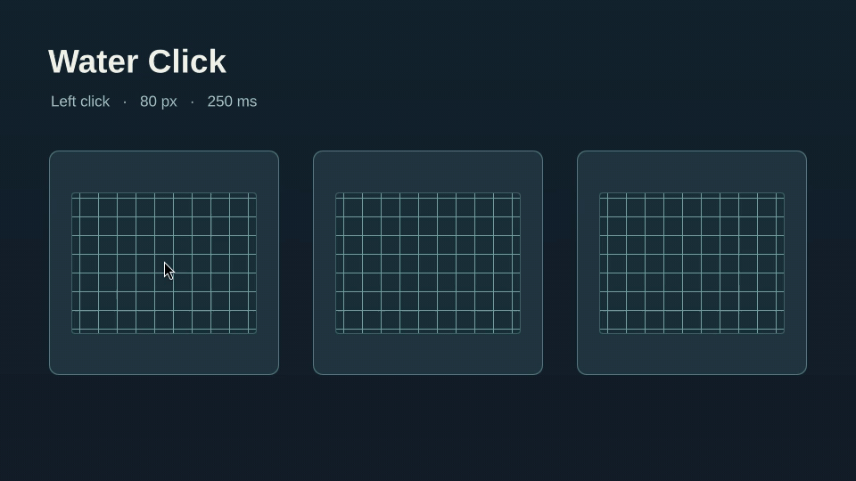

# Water Click

[Русский](README.ru.md)

Water Click adds a ripple at the pointer on left mouse presses in Hyprland.
The default **Short Water** profile refracts the scene within an 80 logical
pixel radius and fades in 250 ms. A new click replaces the previous wave.
Hyprland delivers the click to the desktop, window, or panel as usual.



The [terminal recording](docs/water-click-desktop.gif) shows the same short
Water profile from the original HyprRipple prototype in a live Omarchy session.

Water Click pauses while the session is locked or Hyprland animations are
off. It schedules frames only while a ripple is visible. The ripple is drawn
in Hyprland's compositor, so fullscreen direct scanout can bypass it. The
settings panel follows the Omarchy Shell language in English and Russian.

## Install on Omarchy

Water Click needs a local build of its native Hyprland module. Use Hyprland
headers and libraries from the same build as your running compositor, plus
`make`, a C++23 compiler such as `g++`, `pkg-config`, and the development
files for pixman, libdrm, and OpenGL ES. The module supports Hyprland 0.56
and 0.57 and was tested on 0.56.2 and 0.57.2. Omarchy Shell 4.5 provides the
settings panel.

```sh
omarchy plugin add https://github.com/i4w7w4a/omarchy-water-click --enable
cd "$HOME/.config/omarchy/plugins/io.github.i4w7w4a.water-click" &&
  make &&
  install -Dm755 build/waterclick.so "$HOME/.local/lib/waterclick/waterclick.so" &&
  hyprctl plugin load "$HOME/.local/lib/waterclick/waterclick.so" &&
  hyprctl waterclick get
```

Open the settings panel with
`omarchy-shell shell toggle io.github.i4w7w4a.water-click`. If another
click-effect plugin is active, disable its left-click trigger to see one wave.

To load Water Click at startup, add this line to your Hyprland Lua config:

```lua
hl.plugin.load(os.getenv("HOME") .. "/.local/lib/waterclick/waterclick.so")
```

After upgrading Hyprland, rebuild with matching headers. Run `make clean` and
`make` before installing the new binary. To replace a module currently loaded,
unload it before installing the replacement and load it again afterwards.

## Click effects

Choose an effect in the panel and press **Preview** to play it once over the
sample. **Apply** saves the selection for subsequent left clicks. Choose
**Short Water** and apply it to return to the default.

| Effect | Appearance | Radius | Duration |
| --- | --- | ---: | ---: |
| Short Water | Small refraction wave | 80 px | 250 ms |
| Bold Ink | High-contrast ink disc for recordings | 110 px | 450 ms |
| Ring | Expanding outline | 120 px | 500 ms |
| Sparkle | Ink with a shimmer | 145 px | 650 ms |
| Negative | Inverts the scene within the wave | 115 px | 500 ms |
| Strong Water | Larger refraction wave | 180 px | 800 ms |
| Prism | Refraction with separated colours | 175 px | 700 ms |

The applied effect is stored at
`${XDG_CONFIG_HOME:-$HOME/.config}/waterclick/style`. Preview leaves it as is.

## Pointer

Choose the pointer shape and size in the panel. The sample updates as you
make a selection. **Apply** changes the session cursor and saves the choice
for future sessions. Use **Restore previous cursor** to return to the system cursor.
Choose an arrow, left-handed arrow, or crosshair at 24, 32, 40, 48, 56, or
64 px. The cursor controls use Python 3 and the Xcursor, Cairo, and librsvg
shared libraries included in Omarchy. They write their selection to
`${XDG_STATE_HOME:-$HOME/.local/state}/water-click/cursor.json` and create
Water Click cursor themes in a user icon directory. On Hyprland 0.56,
load the Water Click module for immediate updates to the visible cursor.

Hyprland can update its own cursor and clients that use compositor cursor
shapes. Applications that provide or cache their own cursor may keep that
shape or size, including some XWayland clients.

## Remove

Restore the system cursor in the panel if you applied a custom pointer.
Remove the startup line if you added it. Unload the module if it is loaded,
then remove the binary and the Omarchy panel.

```sh
hyprctl plugin unload "$HOME/.local/lib/waterclick/waterclick.so"
rm -f "$HOME/.local/lib/waterclick/waterclick.so"
omarchy plugin remove io.github.i4w7w4a.water-click
```

## Credits

Water Click reuses and adapts the rendering code for its effects from
[HyprRipple](https://github.com/jgarza9788/hyprripple) by jgarza, including the
short profile developed in [HyprRipple PR #1](https://github.com/jgarza9788/hyprripple/pull/1).
Water Click is an independent project under the [MIT License](LICENSE).
