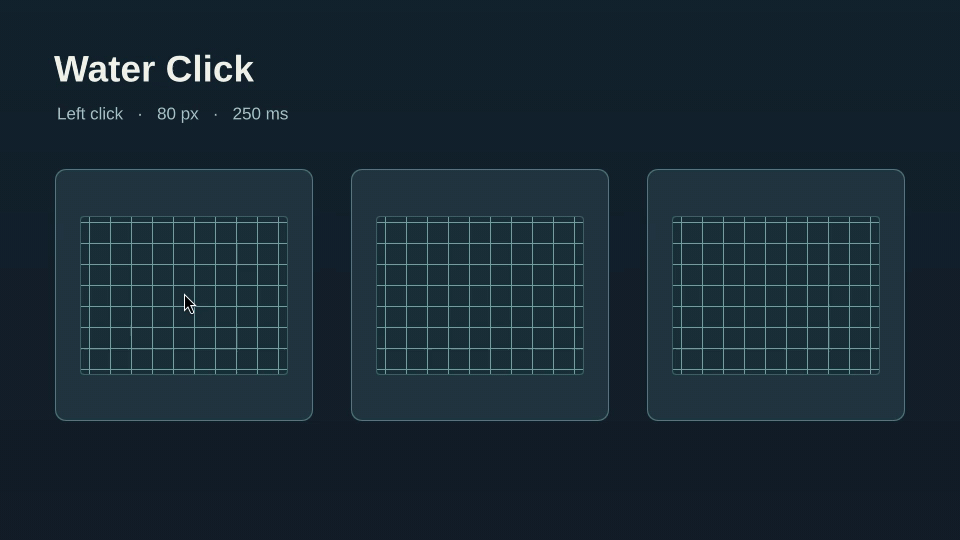

# Water Click

[English](README.md)

Water Click добавляет волну вокруг указателя при нажатии левой кнопки мыши
в Hyprland. Профиль по умолчанию «Короткая волна» преломляет изображение
в радиусе 80 логических пикселей и затухает за 250 мс. Новый клик заменяет
предыдущую волну. Приложения, панель и рабочий стол получают нажатия как обычно.



[Запись терминала](docs/water-click-desktop.gif) показывает тот же короткий
профиль из прототипа HyprRipple в рабочем сеансе Omarchy.

При блокировке сеанса или отключении анимаций Hyprland эффект приостанавливается.
В полноэкранном режиме с прямым выводом (direct scanout) волна может не появиться.
Панель настроек следует языку Omarchy Shell и доступна на русском и английском.

## Установка

Для сборки нужны заголовки и библиотеки той же сборки Hyprland, что запущена в
сеансе, а также `make`, компилятор с поддержкой C++23, `pkg-config` и файлы
разработки pixman, libdrm и OpenGL ES. Модуль поддерживает Hyprland 0.56 и 0.57.
Проверено на 0.56.2 и 0.57.2. Панель настроек работает в Omarchy Shell 4.5.

```sh
omarchy plugin add https://github.com/i4w7w4a/omarchy-water-click --enable
cd "$HOME/.config/omarchy/plugins/io.github.i4w7w4a.water-click" &&
  make &&
  install -Dm755 build/waterclick.so "$HOME/.local/lib/waterclick/waterclick.so" &&
  hyprctl plugin load "$HOME/.local/lib/waterclick/waterclick.so" &&
  hyprctl waterclick get
```

Открыть панель можно командой `omarchy-shell shell toggle io.github.i4w7w4a.water-click`.
Если в сеансе уже работает другой эффект клика, отключите в нём реакцию на
левую кнопку, чтобы видеть одну волну.

Для автозагрузки добавьте в пользовательский Lua-конфиг Hyprland:

```lua
hl.plugin.load(os.getenv("HOME") .. "/.local/lib/waterclick/waterclick.so")
```

После обновления Hyprland пересоберите модуль с подходящими заголовками.
Выполните `make clean` и `make` перед установкой новой библиотеки.
Если старая библиотека загружена, выгрузите её перед заменой и загрузите
новую после установки.

## Эффекты клика

Выберите эффект в панели и нажмите **Предпросмотр**, чтобы проиграть его один
раз на образце. Кнопка **Применить** сохранит выбор для следующих левых
кликов. Чтобы вернуться к исходному эффекту, выберите **Короткая волна** и
примените её.

| Эффект | Как выглядит | Радиус | Длительность |
| --- | --- | ---: | ---: |
| Короткая волна | Небольшое водяное преломление | 80 пикс. | 250 мс |
| Яркий круг | Контрастный круг для записи экрана | 110 пикс. | 450 мс |
| Кольцо | Расходящийся контур | 120 пикс. | 500 мс |
| Искры | Волна с мерцающими частицами | 145 пикс. | 650 мс |
| Негатив | Инверсия изображения внутри волны | 115 пикс. | 500 мс |
| Сильная волна | Более крупное водяное преломление | 180 пикс. | 800 мс |
| Призма | Преломление с разделением цветов | 175 пикс. | 700 мс |

Применённый эффект сохраняется в
`${XDG_CONFIG_HOME:-$HOME/.config}/waterclick/style`. Предпросмотр не меняет этот файл.

## Указатель

Выберите форму и размер указателя в панели. Образец обновится при выборе.
Кнопка **Применить** изменит курсор в сеансе и сохранит выбор для следующих
сеансов. Кнопка **Вернуть прежний курсор** восстановит системный указатель.
Доступны стрелка, стрелка для левши и перекрестие размером 24, 32, 40, 48,
56 или 64 пикс. Для этих настроек нужны Python 3 и библиотеки Xcursor, Cairo
и librsvg из Omarchy. Выбор сохраняется в
`${XDG_STATE_HOME:-$HOME/.local/state}/water-click/cursor.json`, темы Water Click
создаются в пользовательском каталоге значков. Для мгновенной смены видимого
указателя в Hyprland 0.56 загрузите нативный модуль Water Click.

Hyprland обновляет свой указатель и указатели приложений, использующих
формы композитора. Приложения со своим или закэшированным курсором могут
сохранить прежний вид, в том числе некоторые программы XWayland.

## Удаление

Если меняли указатель, восстановите системный в панели. Удалите строку
автозагрузки, если добавляли её. Выгрузите модуль, если он
загружен, и удалите библиотеку и панель.

```sh
hyprctl plugin unload "$HOME/.local/lib/waterclick/waterclick.so"
rm -f "$HOME/.local/lib/waterclick/waterclick.so"
omarchy plugin remove io.github.i4w7w4a.water-click
```

Для отрисовки волны использован и адаптирован код
[HyprRipple](https://github.com/jgarza9788/hyprripple), автор jgarza. Water Click
распространяется по [лицензии MIT](LICENSE).
